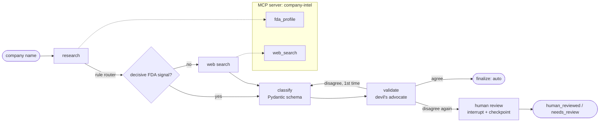

# Company Classifier: Multi-Agent Pharma Company Classification (LangGraph + MCP)

Classifies pharmaceutical-industry companies into an 8-class business-model taxonomy using evidence from FDA drug labels and the web. Built as a LangGraph agent with a research node, a classifier, an independent validator, retry-with-feedback, human-in-the-loop review, an MCP tool server and LangSmith tracing, and evaluated against a single-LLM-call baseline on a dev set and a held-out set committed to git before any model ran.

This is a code-native rebuild of a production company-classification pipeline (the original runs in n8n at about 20,000 companies a month).

| Result (held-out, 32 unseen companies) | Value |
|---|---|
| Agent accuracy (strict / lenient) | **0.94 / 0.97** |
| Single-call baseline with the same evidence | 0.91 / 0.91 |
| Validator-forced retries that fixed the answer / broke it (all 97 companies) | **2 / 0** |
| Cost per company | **~$0.005** (gpt-5-mini) |
| Median latency | ~14 s |

---

## The problem

openFDA lists thousands of "manufacturers", but most of them don't manufacture anything. A large share are **repackagers** relabelling drugs made by others, **retailers** selling store brands, **distributors** filing labels for own-brand supplies, or **consumer and cosmetic companies** with sunscreen and sanitizer claims. Names don't help: *NuCare Pharmaceuticals* and *PD-Rx Pharmaceuticals* are repackagers; *American Health Packaging* repackages drugs; *HealthFirst*'s FDA labels look exactly like a generic injectables maker's.

**Taxonomy (8 classes):** `innovator_pharma` · `generic_manufacturer` · `repackager` · `distributor` · `store_brand` · `consumer_health` · `homeopathic` · `personal_care`

---

## Architecture



| Component | What it does |
|---|---|
| **fda_profile tool** | Pulls up to 100 of a company's openFDA labels and condenses them into about 15 signals: Rx/OTC mix, brand-equals-generic share, **share of labels made by other companies**, repackaged text, homeopathic (HPUS), sunscreen (SPF + number), sample brands. Retries with backoff and shrinks the page on openFDA 500s. |
| **web_search tool** | Tavily search on the exact company name; returns 3 snippets with URLs. |
| **research node** | Always fetches the FDA profile; a **rule-based router** skips web search only when a decisive signal exists (branded Rx, strongly homeopathic, sunscreen/sanitizer). |
| **classify node** | Structured output (`Literal` label, bounded confidence, evidence list) with a domain **evidence guide** in the prompt. |
| **validate node** | Independent reviewer that must name the **strongest alternative class** before agreeing. A disagreement sends its objection back to the classifier once; a second disagreement escalates to a human. |
| **human_review node** | LangGraph `interrupt()` pauses the graph; the checkpointer resumes it after the reviewer answers. Reviewer input is validated against the taxonomy. |
| **MCP server** | `company-intel` exposes both tools over MCP (stdio). The graph can fetch evidence through it (`USE_MCP=1`) or call the functions directly. |
| **Reliability** | Every LLM call has retries plus a fallback model (`gpt-5-mini` → `gpt-4.1-mini`); tool calls retry with exponential backoff; a failed web search degrades to FDA-only evidence instead of crashing. |
| **Tracing** | LangSmith records every node, LLM call, tool call, token count and latency. |

---

## Evaluation

- **Dev set:** 65 companies, 8–9 per class, exact openFDA names, including deliberate traps. Ambiguous companies carry acceptable alternatives (`also_ok`), so accuracy is reported strict and lenient.
- **Held-out set:** 32 different companies, 4 per class (including dental distributors whose FDA labels are own-brand anaesthetics), **committed to git before any model run**.
- **Same cached evidence for every version**, so differences come from reasoning, not data.

### Results

| Version | Dev strict | Dev lenient | Held-out strict | Held-out lenient | Latency |
|---|---|---|---|---|---|
| One LLM call | 0.80 | 0.83 | - | - | ~5 s |
| One LLM call + evidence guide | 0.91 | 0.91 | 0.91 | 0.91 | ~5 s |
| **LangGraph agent** | **0.95** | **0.97** | **0.94** | **0.97** | ~14 s |

Web search used for 69–72% of companies. Across all 97: 2 validator retries, both fixing a wrong answer; none breaking a right one. Human review triggered 0/97 in the eval runs.

---

## Key findings

**1. The baseline exposed exactly where agents were needed.** The one-call classifier was perfect on innovators, generics and store brands, but got 4/8 repackagers and 2/7 distributors. Distributors file FDA labels for their own-brand products, so their business model is invisible in label data. That measured gap is why the agent does web research, rather than agents being added for their own sake.

**2. Domain knowledge in the prompt beat architecture at first.** The 4 missed repackagers had a "made by others" share of 0.62–0.77, higher than the correctly classified Bryant Ranch, but the model ignored that signal in favour of the keyword "repackaged". A short evidence guide explaining what each signal means took accuracy from **0.80 to 0.91** with no model change.

**3. LLM confidence was uncalibrated.** Wrong answers came back at 0.90–0.95 confidence, so "escalate if confidence < 0.8" would have caught almost nothing. Escalation is driven by an independent validator instead.

**4. Same-model self-checking produces correlated errors.** The first validator rubber-stamped wrong answers: the same model, evidence and guide share the same blind spots. Two fixes: a **rule-based router** (the LLM was overconfident about when it had enough evidence, so known-ambiguous profiles always get web research) and a **devil's-advocate validator** that must argue the strongest alternative.

**5. The self-correction loop works on real cases.** HealthFirst: classify said *generic manufacturer*; the validator disagreed, citing the company's **NAICS 423450 wholesaler registration** from the web results; the retry with that objection returned *distributor*.

**6. Ambiguous evidence escalates instead of failing silently.** Lannett (a generic maker that also distributes partner products) sits exactly on the guide's 0.30 "made by others" threshold. The classifier and validator disagreed twice, so the case went to human review rather than shipping a label.

**7. No overfitting.** The guide and routing rules were written on the dev set, but held-out accuracy (0.94) matched dev (0.95).

**8. Small features need contrasting tests.** The first homeopathic signal matched storage temperatures ("store at 20 C" looks like a "30C" potency), and the sunscreen signal matched photosensitivity warnings. Testing on a generic maker that should score zero exposed both.

**9. Human input needs validation too.** The first human-review test accepted a misspelt label (`distributer`). LLM output was already schema-constrained; the reviewer path now re-prompts on anything outside the taxonomy.

---

## Cost and scale

LangSmith: 2 companies, 6 `gpt-5-mini` calls, **$0.01**, so about **$0.005 per company**. At 20,000 companies a month that's roughly **$100/month** in LLM cost, plus web searches for the ~70% that need them. Latency (~14 s) suits overnight batch classification, not real-time use.

## Why MCP

The tools run as an MCP server so any MCP client (this agent, Claude Desktop, other agents) can use them. The practical driver was **environment isolation**: a related RAG project is pinned to LangChain 0.3 for RAGAS, while this one needs LangChain 1.x. Separate MCP processes share tools without sharing dependencies. A direct-call path is kept so both routes can be checked for identical evidence.

## Limitations

- **The validator disagrees rarely** (2/97), so human review almost never triggers and 3 errors passed silently (American Health Packaging, Major Pharmaceuticals, Clarion Brands). Next step: route every case without a decisive signal to a sampled human audit.
- **Small held-out set:** one company is about 3 points.
- **Gold labels from one annotator** using domain knowledge; 9 genuinely ambiguous companies carry acceptable alternatives.
- **Run-to-run variation:** the same company can need a retry on one run and not the next.
- **Entity resolution not built yet:** openFDA has many spellings of one company (9 for Walgreens, 10 for Dr. Reddy's). Test groups are in `eval/entity_groups.json`.

---

## Run it

```bash
python -m venv .venv
pip install langgraph langchain-openai langchain-tavily python-dotenv requests mcp langchain-mcp-adapters

# .env
#   OPENAI_API_KEY=...
#   TAVILY_API_KEY=...
#   LANGSMITH_TRACING=true          (optional)
#   LANGSMITH_API_KEY=...           (optional)
#   LANGSMITH_PROJECT=company-classifier

python src/graph.py "Bryant Ranch Prepack"               # classify one company
HITL=1 python src/graph.py "Lannett Company, Inc."       # pause for human review when needed
USE_MCP=1 python src/graph.py "Cipla USA Inc."           # fetch evidence through the MCP server

python src/baseline.py                                    # single-call baseline (USE_GUIDE=0 to disable the guide)
python src/eval_graph.py                                  # agent eval
EVAL_FILE=eval/heldout_eval.jsonl python src/eval_graph.py
```

## Repository layout

```
src/
  tools.py              fda_profile (openFDA evidence) and web_search (Tavily), traced with @traceable
  schema.py             taxonomy, evidence guide, Classification schema
  graph.py              LangGraph agent: research, classify, validate, retry, human review
  mcp_server.py         company-intel MCP server exposing both tools
  mcp_client_test.py    lists and calls the MCP tools
  baseline.py           single-LLM-call baseline
  eval_graph.py         agent eval: accuracy, web rate, retries, silent errors, latency
  explore_companies.py  manufacturer counts from openFDA
  inspect_profiles.py   print cached profile signals
eval/
  companies_eval.jsonl  65-company dev set
  heldout_eval.jsonl    32-company held-out set
  entity_groups.json    name-variant groups for entity resolution
  runs/                 timestamped per-company results
  RESULTS.md            results log
```
